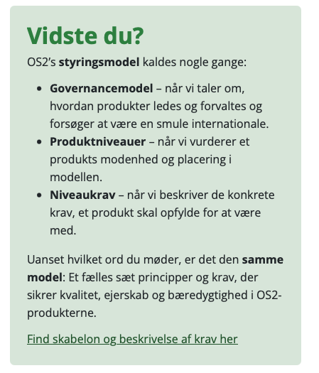

# 2. **Analyse af audit.os2.eu hjemmesiden:**

Denne analyse ser på, hvordan audit.os2.eu fungerer for de produktforvaltere, der skal bruge sitet i forbindelse med selvevalueringen. Jeg har især kigget på, om det er tydeligt, hvor man skal starte, hvordan man finder rundt, hvad de forskellige sider og begreber betyder, og hvilke dele af sitet der faktisk er relevante for produktforvalteren.

Analysen bygger på min egen gennemgang af sitet, en brugertest med Mathias fra OS2ai og input fra de interviews, jeg har lavet med produktforvaltere. På tværs af materialet går især problemer med navigation, uklare begreber, tekniske barrierer og uklarhed om processen igen.

På den baggrund peger jeg på en række steder, hvor sitet kan gøres mere overskueligt, og skitserer et forslag til en enklere struktur, hvor navigationen i højere grad følger det forløb, produktforvalteren selv går igennem: fra introduktion og selvevaluering til feedback, rettelser og endelig offentlig vurdering.

## **HVAD UNDERSØGES:**
Analyse af **audit.os2.eu** med fokus på hvordan forløbet formidles med forslag til ændring i struktur og navigation, så sitet bliver mere overskueligt. Der ses blandt andet på skellet mellem brugerrettet indhold og den mere tekniske backend/generator samt organiseringen af sider, overskrifter og beskrivelser. 

## **HVORDAN**: 

**Min egen analyse: walkthrough (Light et al., 2018).**\
Jeg gennemgår audit.os2.eu systematisk med inspiration fra walkthrough-metoden hos Light et al. (2018) og undersøger, hvordan sitets struktur, navigation og indhold guider produktforvalteren gennem governanceprocessen. I analysen inddrager jeg særligt Light et al.s begreb _environment of expected use_ som analytisk blik på, hvilket formål og hvilken brug sitets enkelte dele lægger op til, og hvilken bruger de synes at forudsætte. 

**Brugertest med Mathias fra OS2ai (Hertzum, 2020).**\
For en detaljeret gennemgang af, hvordan sitet opleves af en produktforvalter, har jeg lavet en brugertest med Mathias, product owner på sandkasseprojektet OS2ai, som ikke har udfyldt selvevalueringen endnu – han ser sitet med friske øjne. Mathias gennemgår en række opgaver, jeg har forberedt, tænker højt undervejs, og jeg observerer ham og følger op med spørgsmål undervejs og efter hver opgave. Det tager udgangspunkt i Hertzums model med grundelementerne: instruktioner og opgaver, verbalisering og aflæsning af brugeren (Hertzum, 2020, s. 2–3).

**Affordances som analytisk linse (Davis, 2020).**\
Som analytisk blik på brugerfladen inddrager jeg Davis’ affordancebegreb. Frem for blot at spørge, _hvad_ en teknologi muliggør, foreslår Davis at undersøge, _hvordan_ den guider, muliggør eller begrænser bestemte handlinger. I analysen har jeg især brugt begreberne **perception** og **dexterity** som linse: om brugeren kan gennemskue, hvilke funktioner og handlemuligheder sitet tilbyder, og om brugeren har de nødvendige kompetencer til at benytte dem. Dermed bliver det relevant at undersøge, hvordan audit.os2.eu fungerer for produktforvaltere med forskellige grader af teknisk erfaring. Fra de 6 interviews har jeg netop spurgt produktforvalterne til deres kendskab til sitet og hvordan det opleves at navigere der; interviewempirien indgår som baggrund for, hvordan jeg forestiller mig sitet opleves.

Referencer:\
Light, B., Burgess, J., & Duguay, S. (2018). The walkthrough method: An approach to the study of apps. _New Media & Society, 20_(3), 881–900. https://doi.org/10.1177/1461444816675438

Hertzum, M. (2020). _Usability testing: A practitioner's guide to evaluating the user experience_. Morgan & Claypool. https://doi.org/10.1007/978-3-031-02227-2

Davis, J. L. (2020). _How artifacts afford: The power and politics of everyday things_. MIT Press. https://doi.org/10.7551/mitpress/11967.001.0001

**Gennemgangsvilkår:**

* Dato for gennemgang: løbende fra d.3 september til 6. november 2026

* Siteversion (stående på forsiden): Version v0.1.0 – udgivet 4. maj 2026

* Browser: Safari, version 26.5.2 

## **MINE FUND - OG HVAD JEG FORESLÅR ÆNDRES:**

## 1. Det er uklart, hvem sitet henvender sig til, og hvor produktforvalteren skal starte

Forsiden giver et overblik over indholdet på audit.os2.eu, men gør det ikke tydeligt, hvem den primære bruger er. Styregruppen og produkterne omtales i tredje person, mens "du" først dukker op længere nede på siden. Men hvem er "du"? Er sitet både tænkt som offentlig dokumentation af OS2's governance og som arbejdsredskab for dem, der skal gennemføre en selvevaluering? I så fald skal der skelnes tydeligt mellem de to formål, så man som produktforvalter ved, hvor man skal gå hen og levere sin selvevaluering, samtidig med at man som interesseret i OS2's governance-vurderinger stadig kan følge med.

Dette viste sig også i brugertesten, hvor Mathias var forvirret på forsiden. Han efterlyste et tydeligere svar på: "Hvor skal jeg starte?"

Forsidens "På denne side finder du" fungerer i praksis som en vejviser gennem audit-sitet, men rækkefølgen afspejler ikke tydeligt et forløb for en ny produktforvalter. Listen starter med "checklister" til selvevaluering og evaluering, selvom procesbeskrivelsen er det oplagte sted at begynde, hvis man først skal forstå sammenhængen og forskellen på de to. Derefter følger selvevalueringsformularen og til sidst de to generatorer, uden at det er tydeligt, om generatorerne overhovedet er tiltænkt produktforvalteren.

Med Light et al.s (2018) begreb _environment of expected use_, kan det konstateres, at den forventede bruger af sitet ikke tydelig nok.

**Retning:** Gør det tydeligere, hvem sitet primært er til, og giv produktforvalteren en klar indgang til processen. Formuleringen "På denne side finder du" kan desuden med fordel ændres til eksempelvis "På audit.os2.eu finder du" eller "Sitet indeholder", fordi linksene fører videre til undersider på sitet og ikke faktisk ligger på forsiden.

## 2. Begreberne gør det svært at forstå, hvor man er i processen

På sitet bruges blandt andet _evaluering, vurdering, selvevaluering, governancerapport, evalueringsrapport, kladde_ og _tjekliste_. Flere af ordene ligger tæt på hinanden, uden at relationen mellem dem forklares.

Det blev meget tydeligt i brugertesten. Da Mathias blev præsenteret for selvevalueringen, governancerapporten og evalueringsrapporten, var hans første reaktion: "Jamen er det ikke et og samme?" Selv efter at have læst videre kunne han ikke sikkert udlede, hvordan dokumenterne fulgte efter hinanden i processen.

Særligt ordene _selvevaluering, evaluering_ og _vurdering_ giver problemer. _Evaluering_ virker mindre endeligt end _vurdering_, men ligger sprogligt så tæt på _selvevaluering_, at de to let flyder sammen. _Vurdering_ skelner tydeligere, men signalerer til gengæld noget mere endeligt, end sekretariatets første tilbagemelding reelt er.

Det er vigtigt, fordi selvevalueringen ikke bør forstås som en endelig dom over produktet. Interviewene peger tværtimod på, at den opleves og ønskes brugt som et **arbejdsredskab, et øjebliksbillede og et udgangspunkt for dialog**. Produktforvalteren skal kunne svare ærligt på, hvor produktet står nu, få feedback fra sekretariatet og have mulighed for at rette op. Flere interviews peger netop på bekymringer for, at vurderingen kan opleves for hård eller endelig, selv om processen endnu ikke er afsluttet.

Derfor bør sproget på sitet tydeligere understøtte, at selvevalueringen har karakter af en **kladde og et løbende arbejdsdokument**, som indgår i en dialog med sekretariatet. Hvis den første tilbagemelding allerede kaldes en _vurdering_, kan det give indtryk af, at resultatet er fastlagt, før produktet har haft mulighed for at reagere.

En tydeligere opdeling kunne derfor være at omtale sekretariatets første tilbagemelding som **feedback**, mens **(endelig) vurdering** først bruges efter dialogen og muligheden for at rette til. Dermed bliver det lettere at se forskel på produktets selvevaluering, sekretariatets feedback og den efterfølgende vurdering.

OS2 bruger allerede en "Vidste du?"-boks til at forklare forskellen på beslægtede [governancebegreber på hjemmesiden](https://www.os2.eu/governance). En lignende tilgang kunne være relevant her.

**Retning:** Forklar det centrale begrebsapparat og brug betegnelserne mere konsekvent gennem processen. Gør samtidig tydeligt, at selvevalueringen er et arbejds- og dialogværktøj frem for en endelig vurdering. Overvej at bruge _feedback_ om sekretariatets første tilbagemelding og reservere _(endelig) vurdering_ til det tidspunkt, hvor produktet har haft mulighed for dialog og rettelser.

## 3. Navigationen bruger for mange overlappende og skiftende begreber

Navigationsmenuen indeholder mange undersider, hvor flere af navnene minder meget om hinanden. _Selvevaluering, governancerapport_ og _evalueringsrapport_ optræder samtidig forskellige steder under _Evalueringer, Vurderingsgrundlag og Rapporter._ Når forskellen mellem begreberne i forvejen er svær at gennemskue, bliver det endnu sværere at forstå navigationen.

Forsidens egen oversigt bruger samtidig andre betegnelser end navigationen. Fx bliver “checkliste til selvevaluering” til _Governancerapporten_, “checkliste til evaluering” til _Evalueringsrapporten_ og “Procesbeskrivelse” til _Processen_. Brugeren skal dermed oversætte mellem forsidens ord og navigationens betegnelser for at finde det samme indhold.

Der findes også både _Log_ og _Beslutningslog_, uden at forskellen mellem dem fremgår af navigationen.

_Det nuværende navigationsoverblik_

**Retning:** Brug de samme begreber på forsiden og i navigationen, og giv siderne navne, der tydeligere fortæller, hvad de indeholder og hvem de er relevante for.

## 4. Sidernes struktur følger ikke produktforvalterens vej gennem processen

Problemet handler ikke kun om navngivning. Der er også overlap mellem siderne og en struktur, som ikke altid følger den rækkefølge, produktforvalteren har brug for.

Det viste sig også i brugertesten. Da Mathias skulle finde procesbeskrivelsen uden at bruge linket på forsiden, begyndte han under _Evalueringer_, fordi den lå øverst, og måtte derefter trevle resten af punkterne igennem, før han fandt _Processen_ under _Vurderingsgrundlag_. Placeringen var ikke altså intuitiv for ham.

Under _Vurderingsgrundlag_ introduceres selve evalueringsprocessen samtidig allerede på oversiden, selv om der findes en særskilt underside med navnet _Processen_, som gennemgår forløbet mere udførligt. Det bliver derfor uklart, hvad de to sider hver især skal bruges til, når de gentager hinanden så meget.

Her ville en tydeligere arbejdsdeling hjælpe: _Processen_ bør forklare, hvad der sker hvornår og hvem der gør hvad, mens _Vurderingsgrundlaget_ bør koncentrere sig om, hvad produktet bliver vurderet på.

Rækkefølgen i navigationen kan samtidig i højere grad følge produktforvalterens proces. En ny bruger har brug for først at forstå processen og vurderingsgrundlaget, derefter udfylde selvevalueringen og til sidst orientere sig i feedback, vurdering og offentliggørelse.

**Retning:** Forenkle informationsarkitekturen, reducér overlap mellem siderne og lad navigationens rækkefølge følge brugerens vej gennem processen.

## 5. Det er uklart, hvilke værktøjer der er til produktforvalteren, og hvilke der er til sekretariatet

Flere dele af sitet fremstår som lige relevante for produktforvalteren, selv om nogle af dem snarere ser ud til at høre til sekretariatets arbejdsgang.

Et eksempel er de to generatorer, som både ligger i den navigations menuen til venstre og fremhæves på forsiden. Instruktionen i toppen af selvevalueringsformularen siger, at produktforvalteren skal eksportere sine svar som JSON og sende filen eller et GitHub-link til sekretariatet. Der nævnes ikke at man trække sine data igennem governancerapport- og evalueringsrapport-generatorerne. Det peger på, at generatorerne først bliver relevante efter afleveringen og derfor primært hører til sekretariatets arbejde. Hvis generatorne er tiltænkt at bruges at produktforvalterne, er dette ikke tydeligt. 

Usikkerheden bliver forstærket af, at forsiden direkte linker til muligheden for at “generere en kladde” til evalueringsrapporten. Når en funktion ligger i den primære navigation eller ligefrem fremhæves på forsiden, vil den som produktforvalter let fremstå som noget, man forventes at bruge. Når det samtidig ikke forklares hvordan, hvornår eller hvorfor generatorerne skal bruges, skaber det tvivl om, hvor produktforvalterens opgave egentlig stopper.

Mathias havde samme oplevelse i brugertesten. Han var i tvivl om, hvad der var tiltænkt ham, og vurderede, at generatorerne “støjer mere eller forvirrer end det gavner”, hvis de primært er redskaber for sekretariatet. Det hænger sammen med hans mere generelle spørgsmål om, hvor man skal starte, fordi alle dele af sitet fremstår som noget, brugeren bør forholde sig til.

Davis' (2020) affordancebegreb er relevant her: Når en funktion er synlig, tilgængelig og placeret side om side med andre centrale funktioner, signalerer interfacet også, at den er relevant for brugeren. Men hvis målgruppen ikke er tydelig, bliver produktforvalteren derfor nødt til selv at afgøre, om funktionen faktisk er en del af deres opgave, på et site der allerede har meget andet information.

Det samme gælder siden med selvevalueringer under _Rapporter_. Hvis de første udkast ikke længere skal offentliggøres, er der ikke meget grund til at have en særskilt side til dem i den primære navigation. Efter den endelige vurdering kan de i stedet samles under fx _Vurderede governancerapporter_, så det bliver tydeligt, hvilket materiale der er tiltænkt en offentlig læser.

Det er positivt, at OS2 dokumenterer sine arbejdsmetoder åbent, men åbenhed behøver ikke betyde, at alle tekniske værktøjer skal ligge i den primære brugerrettede navigation. Hvis generatorerne primært er backend-værktøjer for sekretariatet, kan de fortsat være offentligt tilgængelige via GitHub eller teknisk dokumentation uden at fremstå som et trin, produktforvalteren skal igennem. Hvis det derimod er meningen, at produktforvalterne selv skal bruge generatorerne, skal det angives langt tydeligere, herunder hvornår i processen de skal bruges, hvad de skal bruges til og hvordan de hænger sammen med afleveringen.

**Retning:** Gør det eksplicit, hvad produktforvalteren skal bruge, og hvad der hører til sekretariatets arbejdsgang. Funktioner, der fremhæves i navigationen eller på forsiden, bør enten være klart relevante for produktforvalteren eller markeres tydeligt som noget andet. Hvis generatorerne primært er interne arbejdsredskaber, bør de flyttes ud af den primære brugerrejse. Hvis produktforvalterne forventes at bruge dem, skal det forklares tydeligt.

## 6. Den tekniske løsning forudsætter mere teknisk kunnen, end nogle produktforvaltere har

Mathias kunne relativt hurtigt forstå flowet fra formular til JSON og videre til GitHub eller mail. Han arbejder selv med JSON og Git, men vurderede samtidig, at mindre tekniske projektledere ville møde en barriere ved netop denne del af processen.

Det stemmer med interviewmaterialet, hvor manglende teknisk baggrund går igen, og hvor der blandt andet efterspørges hjælp til JSON og GitHub fx en mere udførlig guide til hvordan man kan downloade filen ned og afleverer ens JSON-fil. Formularen lægger op til, at den kan udfyldes direkte i browseren, hvilket nogle produktforvaltere gjorde, men de var ikke klar over arbejdet ikke ville blive gemt og de mistede derfor deres arbejde efter de refreshede siden. 

Med Davis' (2020) begreb _dexterity_ understreges det, at sitets brugervenlighed hænger sammen med hvilke færdigheder sitet forudsætter hos den bruger, der skal kunne benytte funktionen. Interviewdataene tyder på, at der er stor spredning i produktforvalternes tekniske kunnen. Det er derfor nødvendigt at den tekniske barriere for udfyldning rammer laveste fællesnævner, så alle kan være med.

**Retning:** Undersøg om afleveringsflowet kan forklares eller understøttes bedre for produktforvaltere uden teknisk baggrund.

## 7. Formularen skal tydeligt indikere, om selvevalueringen offentliggøres før eller efter mulighed for rettelser

Det fremgår ikke tydeligt nok af audit-sitet, hvilken status selvevalueringen har, mens produktforvalteren udfylder den. Problematikken omkring åbenhed, offentliggørelse og hvornår vurderingen bliver endelig behandles nærmere i [delanalyse 3 om processen.](https://anna-leland.github.io/digi-suveraenitet-i-praksis/docs/os2forloeb2026/selvevalueringer/3-analyse-gov-processen.html)

Det kan aflive tvilen om hvorvidt ens selvevaluering lægges åbent op eller ej, hvis det kommunikeres helt klart i toppen af formularen. Produktforvalteren bør vide, hvad besvarelsen skal bruges til, inden man begynder at skrive. Hvis selvevalueringen skal fungere som et arbejds- og dialogværktøj, bør det være tydeligt, at første besvarelse er en kladde til videre dialog – og hvis den kommer til at ligge offentligt, som de første 7 selvevalueringsrapporter gjorde i en periode, så skal det i så fald angives i toppen af formularen.

På selve formularen kunne det fx kommunikeres i en fremhævet boks:

> **Selvevalueringen er et arbejdsdokument**\
> Din første besvarelse bruges internt i dialogen mellem produktet og OS2-sekretariatet. Efter sekretariatets feedback får produktet mulighed for at opdatere besvarelsen og dokumentationen, før processen afsluttes.

**Retning:** Gør dokumentets status tydelig dér, hvor selvevalueringen udfyldes, så produktforvalteren fra starten ved, hvad besvarelsen bruges til.

______

# Forslag til ny struktur for audit.os2.eu

Forslag til ny navigation på audit.os2.eu. Herunder konkrete forslag til hvordan indholdet kunne omstruktureres til de enkelte undersider.

_Forslag til nyt navigationsoverblik_

## Forside

Forsiden skal kort forklare, hvad audit.os2.eu er, og hvor brugeren skal gå hen.

Her bør stå:

* en kort forklaring af sitets formål

* hvem sitet primært henvender sig til

* en tydelig indgang: **Her starter du**

* et kort overblik over forløbet:\
  **forstå → udfyld → aflever → feedback → ret til → endelig vurdering**

* en sekundær indgang til **Offentlige vurderinger**

Forsiden skal ikke gentage hele navigationsmenuen i en separat liste.

***

## Start her

Siden skal besvare:

> **Hvad går selvevalueringen ud på?**

Her bør stå:

* hvorfor OS2 laver selvevalueringer

* at selvevalueringen er et løbende governance- og dialogværktøj

* hvem der overordnet har ansvar

* en kort forklaring af de vigtigste begreber

* en lille “Vidste du?”-/ordbogsboks

* det korte procesflow

* tydelige links til **Processen**, **Vurderingsgrundlaget** og **Udfyld selvevaluering**

### Governance-processen

Siden skal besvare:

> **Hvad sker der hvornår, og hvem gør hvad?**

Her bør stå:

* procesdiagrammet

* hvornår selvevalueringen udfyldes

* hvem der afleverer hvad til hvem

* sekretariatets feedback

* dialogen med produktet/styregruppen

* mulighed for at rette dokumentation eller faktiske mangler

* ny aflevering

* endelig vurdering

* bestyrelsens rolle

* offentliggørelse

* årshjul og frister

* roller, når de er relevante for at forstå processen

Det skal stå tydeligt, hvornår materialet er **kladde/internt**, og hvornår noget bliver **endeligt/offentligt**.

### Vurderingsgrundlaget

Siden skal besvare:

> **Hvad bliver produktet vurderet på?**

Her bør stå:

* produktniveauerne

* hvordan kravene stiger med niveauet

* de fire områder: relevans, formkrav, governance og strategisk sammenhæng

* hvad sekretariatet ser efter

* hvilken rolle dokumentation spiller

* hvordan vurderingen foretages

* forklaring af trafiklys, hvis de fortsat anvendes

* link til selvevalueringsformularen med de konkrete krav

Siden skal ikke samtidig gennemgå hele evalueringsprocessen.

Man kunne med fordel også linke til Sisses [håndbog til styringsmodellen](https://boks.os2.eu/s/Di5cTQdSABd6ak4?dir=/Arrangementer/OS2%20Community-meetup/OS2%20Community-meetup%20%231_2025/Governance-rapport%20workshop&editing=false&openfile=true).
Og så henvise til [styringsmodellen formuleret af Strand og Donslund](https://boks.os2.eu/s/5mE8j8RLQeM4L7w?dir=/&editing=false&openfile=true), til dem der gerne vil helt ned i materien. 
***

## Selvevaluering af governance

Siden skal besvare:

> **Hvordan laver og afleverer jeg min selvevaluering?**

Her bør kort stå:

* at selvevalueringen er produktets eget øjebliksbillede

* at den første version er et internt arbejdsdokument/kladde

* at ærlige svar er ønskelige, også hvor produktet har mangler

* links til **Udfyld selvevaluering** og **Aflevering og hjælp**

### Udfyld selvevaluering

Her ligger selve formularen.

Øverst bør det fremgå tydeligt:

* at første besvarelse er intern og ikke offentliggøres i denne form

* at den bruges som udgangspunkt for feedback og dialog

* at produktet får mulighed for at opdatere efter sekretariatets feedback

* hvordan filen hentes ned, i hvilke fil-formater den kan behandles i og hvordan man løbende gemmer

### Aflevering og hjælp

Siden skal besvare:

> **Jeg er færdig – hvad gør jeg nu?**

Her bør stå:

* hvordan selvevalueringen afleveres som JSON fil

* hvordan en eksisterende selvevaluering genoptages og opdateres

* kontakt til sekretariatet ved spørgsmål eller problemer

***

## Efter aflevering

Siden skal kort forklare, at arbejdet ikke afsluttes ved afleveringen. Herefter begynder dialogen med sekretariatet.

### Feedback og mulighed for rettelser

Siden skal besvare:

> **Hvad betyder sekretariatets første tilbagemelding?**

Her bør stå:

* at første tilbagemelding er **feedback**, ikke en endelig vurdering

* hvordan sekretariatet gennemgår selvevalueringen

* hvad trafiklys på dette tidspunkt betyder

* at manglende dokumentation ikke nødvendigvis betyder, at produktet reelt ikke opfylder kravet

* mulighed for at forklare, supplere dokumentation eller foretage ændringer

* hvordan en ny aflevering foregår

* hvordan dialogen mellem sekretariatet og produktet/styregruppen foregår - emails, online- eller fysiske møder

### Endelig vurdering og offentliggørelse

Siden skal besvare:

> **Hvornår bliver resultatet endeligt, og hvad bliver offentliggjort?**

Her bør stå:

* hvornår feedbackfasen afsluttes

* hvordan den endelige vurdering fastlægges

* hvordan produktniveauet indgår

* bestyrelsens rolle

* hvad der offentliggøres

* hvor det offentliggøres

* hvad der ikke offentliggøres

* tydeligt skel mellem den interne selvevaluering og den endelige vurderingsrapport

***

## Offentlige governance-vurderinger

Denne del af sitet samler den dokumentation, der er relevant for medlemmer, bestyrelsen, eksisterende og potentielle anvendere samt andre, der ønsker indsigt i OS2-produkternes governance-status.

### Vurderingsrapporter

Her ligger de endelige vurderingsrapporter.

En vurderingsrapport kan indeholde:

* relevante oplysninger fra produktets selvevaluering

* sekretariatets endelige vurdering

* vurderingsgrundlag/begrundelse

* anbefalinger

* produktniveau

Den endelige vurderingsrapport er det dokument, en udenforstående skal orientere sig i.

### Beslutningslog

Siden samler formelle beslutninger om projekter og produkter, eksempelvis:

* ændring af produktniveau

* optagelse i porteføljen

* udtræden

* pausering eller lukning

* andre væsentlige beslutninger om produktets status eller retning

For hver beslutning kan fremgå dato, beslutning, grundlag og hvem der traf beslutningen.

### Aktivitetslog

Siden samler væsentlige aktiviteter i evalueringsarbejdet, eksempelvis:

* udsendelse af orienteringsmail

* dialogmøder

* aftaler om udsættelse

* andre væsentlige aktiviteter i evalueringen

* dato og eventuelt ansvarlig

