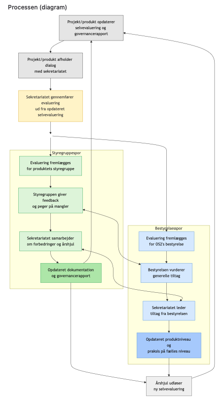
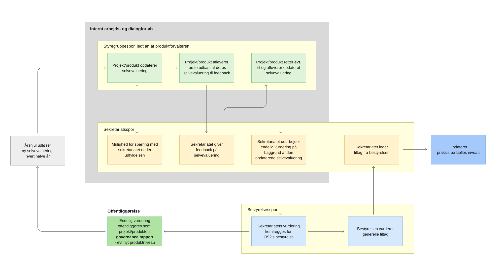

# 3. Analyse af processen omkring selvevalueringer i OS2

### Hvad undersøges og hovedfund 

Interviewene med produktforvaltere viser en gennemgående forvirring om selvevalueringsprocessen: Hvor ofte foregår den, hvad sker der efter aflevering, hvornår kan man rette til, og hvornår bliver noget offentligt? Problemet er ikke hvordan processen er designet, men hvordan den kommunikeres, når at produktforvalterne ikke står tilbage med den samme forståelse af processen.

Analysen ser derfor på kommunikationen af processen omkring selvevalueringen, især orienterings-emailen produktforvalterne blev sendt tilbage d.11 maj, audit.os2.eu og procesdiagrammet på hjemmesiden. Min hovedanbefaling er derfor at gøre kommunikationen om processen mere entydig på tværs af de tre medier. 

### Hvordan?

Analysen bygger på interviews, dokumentanalyse af emailen, walkthrough, brugertest af audit.os2.eu. Interviewanalysen tager især udgangspunkt i 3 temaer, der åbenbarede sig i empirien:
- "Tvetydighed om selvevaluerings årshjul"
- "Ikke orienteret om at selvevaluering skal ligge åbent"
- og "Syn på niv-sætning & vurdering - endelig eller ikke?"

Teori-wise, bruges Hall som blik på forskellen mellem det, OS2 forsøger at kommunikere (encoding), og det produktforvalterne faktisk forstår (decoding). McLuhans begreb om "medium is the message" bruges til at skelne mellem medier og hvad email, hjemmeside og diagram hver især bør bruges til.

Referencer:\
Hall, S. (1993). Encoding, decoding. In S. During (Ed.), _The cultural studies reader_ (pp. 507–517). Routledge.

McLuhan, M. (1964). _Understanding media: The extensions of man_. McGraw-Hill. (Kapitel 1: The medium is the message).

## Hovedfund

### 1. Årshjulet bliver ikke forstået ens

Interviewene viser, at der ikke er en fælles forståelse af, hvor ofte selvevalueringen skal gentages. Det er på trods af, at invitationsemailen lægger op til en proces “forår og efterår”, og forsiden på audit.os2.eu beskriver, at evalueringerne offentliggøres to gange årligt.

Tre af de interviewede produktforvaltere var i tvivl om, hvorvidt processen skulle være årlig eller halvårlig. To var ret sikre på, at den måtte være årlig og ikke burde ske oftere, mens én mente, at den både er og bør være halvårlig, så man løbende har føling med selvevalueringen.

Selvom hyppigheden altså allerede er beskrevet både i emailen og på hjemmesiden, er den ikke blevet tydelig nok for produktforvalterne. Om processen fremadrettet bliver årlig eller halvårlig, bør rytmen derfor meldes endnu klarere ud, fx i procesdiagrammet og i toppen af selvevalueringsformularen. Det kan samtidig kommunikeres ud i produktforvalternetværket, at selvevalueringen skal indregnes som en fast del af produktets årshjul og ikke komme som en ny overraskelse hver gang.

### 2. Åbenhed er ikke kommunikeret tydeligt nok

Temaet om åbenhed i interviewdataen viser, at flere grundlæggende synes, at åbenhed passer naturligt til OS2, men samtidig er usikre på, hvad der konkret bliver offentliggjort og hvornår. Det betyder også, at de ikke nødvendigvis forventer, at det de sidder og udfylder, senere bliver lagt offentligt.

I starten blev de første selvevalueringer, der rullede ind i sensommeren 2026, lagt offentligt på audit.os2.eu. Nogle produktforvaltere fandt det intuitivt, og enkelte nævnte det ligefrem som hjælpsomt, fordi de kunne bruge andre produkters besvarelser som inspiration til deres egen.

Andre havde derimod opfattet selvevalueringen som et internt arbejdsdokument eller en kladde til sekretariatet og blev overraskede over, at den kunne læses offentligt. Nogle nævnte, at de ville have udfyldt formularen anderledes, hvis de havde vidst det. Det kan påvirke, hvor åbent man beskriver mangler og problemer, fx omkring code reviews eller sikkerhedsopsætning, og dermed også hvor retvisende et billede selvevalueringen giver.

Den første vurdering fra sekretariatet blev også lagt offentligt, mens den stadig var under behandling. Det blev modtaget meget negativt af det pågældende produkt, som reagerede på, at både vurderingen og en mulig nedgradering var synlig, før de havde haft mulighed for at kommentere eller arbejde videre med forbedringer. Efter dialog med produktet blev vurderingen og de resterende offentliggjorte selvevalueringer taget ned igen.

Det skift mellem først at lægge materialet åbent og derefter fjerne det har bidraget til usikkerheden om, hvad der bliver offentligt og hvornår. Den usikkerhed ser også ud til at være nået videre til produkter, som endnu ikke havde udfyldt deres selvevaluering.

Det bør derfor kommunikeres tydeligt fra starten, hvilken status selvevalueringen har, hvad der bliver offentliggjort, og på hvilket tidspunkt i processen det sker. Et forslag til en konkret formulering, der kan indsættes over selvevalueringsformularen indgår i fund 6 i analyse 2 om audit.os2.eu-sitet.

### 3. Grænsen mellem feedback og endelig vurdering er uklar

Interviewene viser også usikkerhed om, hvornår sekretariatets tilbagemelding skal forstås som feedback, og hvornår der faktisk ligger en endelig vurdering.

Selvevalueringen bliver på tværs af interviewene opfattet som et arbejdsredskab, som produktet bør kunne arbejde videre med. Flere forventer derfor også mulighed for at reagere på sekretariatets feedback, forklare deres besvarelse, forbedre dokumentationen eller rette en reel mangel, før vurderingen bliver endelig.

Det er vigtigt, fordi sekretariatets første tilbagemelding ikke nødvendigvis siger alt om produktets reelle situation. Et krav kan eksempelvis fremstå som ikke opfyldt, fordi dokumentationen i selvevalueringen mangler, selv om produktet i praksis er tættere på at leve op til kravet. Samtidig viser interviewene, at niveauet betyder meget for nogle produkter, og at en mulig nedgradering derfor opleves som noget, der har reel betydning – især hvis denne lægges offentligt, før man får chance for at reagere på det.

Det eneste interviewede produkt, der på nuværende tidspunkt har modtaget sekretariatets tilbagemelding, var også i tvivl om, hvilken status den havde. De tog efterfølgende dialogen med sekretariatet, blandt andet fordi tilbagemeldingen blev oplevet som mere resolut, end de havde forventet.

Det centrale er derfor at gøre rækkefølgen tydelig:

**aflevering → feedback → mulighed for rettelser → endelig vurdering → offentliggørelse**

Det bør også afspejles i begreberne. Den første tilbagemelding kan fx omtales som **feedback** eller **foreløbig vurdering**, mens **endelig vurdering** først bruges, når dialogen og muligheden for rettelser er afsluttet.

I Mathias' brugertest af audit.os2.eu måtte han selv stykke næste skridt sammen og gætte på, hvornår noget blev offentligt i sin aflæsning af procesdiagrammet og da han navigerede rundt på sitet. Det peger på, at processen godt kan være beskrevet uden nødvendigvis at være tydelig for en produktforvalter, der møder den første gang og derfor ikke er klar over begrebernes betydning og ikke har samme indforståethed omkring processen, som sekretariatet, der har bygget sitet.

### Samlet set

På tværs af de tre temaer er problemet det samme: sekretariatet kommunikerer en proces, men produktforvalterne afkoder ikke nødvendigvis processen på samme måde. Der er altså forskel mellem den tilsigtede kommunikation og den forståelse, modtageren ender med.

Det gælder også selve betegnelserne undervejs. Hvis feedback, evaluering og vurdering bruges om forskellige stadier uden et tydeligt skel, bliver det sværere at forstå, hvornår noget er til dialog, og hvornår det er endeligt.

Det betyder ikke, at hele processen skal forklares endnu i dybden i både orienteringsemailen, på alle hjemmesidens undersider og i procesdiagrammet. Det betyder, at hvert medie har en form, der former hvor høj grad af processen de hver især kan kommunikere på en meningsfuld og tilgængelig måde. Ifølge McLuhans "medium is the message" teori, har en læser forskellige forventninger til hvor meget og hvilken slags information de kan indtage fra hhv. en email, hjemmeside og et diagram. Kunsten er at skabe god sammenhæng imellem de tre, der understøtter den samme forståelse af forløbet, på hver sin måde.

# Ændringsforslag: Bedre kommunikation på tværs
Mit forslag er, at emailen sætter processen i gang, hjemmesiden forklarer den i dybden og diagrammet giver overblikket: 

### Emailen skal være kortere og få produktforvalteren i gang

Emailen er det første møde med processen for mange produktforvaltere, og vil fremadrettet blive en reminder om "nu er det tid til evaluering - igen". Orienteringsemailen bør derfor først og fremmest fortælle, hvorfor man får den, hvad man skal gøre nu, hvornår fristen er og hvor man går hen for at læse mere.

Den første orienteringsemail fra 11. maj forsøgte i højere grad at rumme hele processen og kom derfor til at ligne en FAQ. Den blev så lang, at få kunne huske hvad der stod i den. Fordi det er en email har de også svært ved at finde den frem igen. Jeg ville i stedet bruge emailen som en reminder, med en kort indgang til processen og lade den indeholde henvisningslinks, der uddyber processen ovre på audit.os2.eu.

### Hjemmesiden skal være det faste referencepunkt med en god navigation

Audit.os2.eu bør være det sted, man går tilbage til, hvis man er i tvivl om frister, næste skridt, feedback eller offentliggørelse. Det betyder også, at emailen mister status som referencepunkt, men bliver en orientering, og hjemmesiden bliver en wiki.

Forslagene til en tydeligere forside og simplere navigation på audit.os2.eu behandles allerede i delanalyse 2. 
Det gennemgående problem, der blev afdækket i analysen omkring hjemmesiden, var at det som produktforvalter var svært at gennemskue hvor de skulle starte og hvilke undersider der var relevante for dem. Se uddybning af produktforvalternes udfordringer med hjemmesiden [i del-analyse 2.](https://anna-leland.github.io/digi-suveraenitet-i-praksis/docs/os2forloeb2026/selvevalueringer/2-analyse-UI-audit-sitet.html)

### Procesdiagrammet skal give overblik

Diagrammets vigtigste opgave bør være at gøre forløbet overskueligt fra start til slut. Det skal derfor ikke indeholde alle detaljer; de bliver uddybet på hjemmesidens undersider. Diagrammet skal tydeligt vise rækkefølge, ansvar og overgangen fra internt arbejdsforløb til endelig offentlig vurdering.

På baggrund af interviewempiri, brugertesten med Mathias (som aldrig havde set diagrammet før) og min egen walkthrough-analyse, har jeg lavet et forslag til et ny version af procesdiagrammet, hvor processen forhåbentligt kommunikeres tydeligere. 

Det oprindelige procesdiagram giver et fint overblik over, at både styregruppe og bestyrelse indgår i processen, men flere af overgangene er svære at forstå. Styregruppen kommer først visuelt ind efter sekretariatets evaluering, selv om styregruppen og produktforvalteren allerede har ansvar for selvevalueringen fra starten. Samtidig er det uklart, hvad “dialog med sekretariatet” dækker over, og hvornår processen går fra første aflevering til feedback, rettelser og endelig vurdering.\
Diagrammet ville have gavn af at tydeliggøre feedback og dialog som et stadie før den endelige vurdering, så sekretariatets første tilbagemelding ikke kommer til at fremstå som processens endelige resultat. 

Bestyrelsessporet er også svært at aflæse. Det fremgår ikke tydeligt, hvad “generelle tiltag” betyder, eller hvad pilene mellem styregruppe- og bestyrelsessporet viser. Sekretariatet optræder samtidig flere steder i begge spor, selv om sekretariatet i praksis har sin egen rolle mellem produktet og bestyrelsen.

I mit forslag har jeg derfor lavet **tre tydelige spor for styregruppe, sekretariat og bestyrelse**. Det gør det lettere at se, hvem der har ansvar hvornår, og gør feedbackforløbet mere tydeligt:\
første aflevering → sekretariatets feedback → eventuelle rettelser → endelig vurdering.\
Jeg har også markeret det interne arbejds- og dialogforløb særskilt fra offentliggørelsen, så det bliver tydeligt, hvornår processen går fra intern behandling til et offentligt resultat.

Jeg har samtidig lavet diagrammet **horisontalt og mere lineært**, så processen læses fra venstre mod højre. Det var også noget Mathias efterspurgte i brugertesten, hvor han oplevede det oprindelige diagram som overvældende, især da man ikke kunne overskue det i ét browservindue, fordi det var så højt. Det nye forslag udnytter samtidig 'dead space' på siden ved at lægge diagrammet horisontalt. 

**En note om formater**: Det er mit indtryk, at formuleringerne i tekstboksene til dels er skyld i manglende overblik i diagrammet, men det virker også til, at selve Mermaids-diagram struktur er med til at spænde ben. Jeg har derfor tegnet mit diagram i Figma, men downloadet det som en SVG-fil, så den kan lægges ind i .md-filer og trods man giver afkald på versionsstyringen i Git som Mermaid tilbyder, vil SVG-filen kunne hentes ned og nemt redigeres i fx. Figma og lægges op igen uden at miste kvaliteten, som hvis det havde været fx et PNG.

**Nuværende proces-diagram**

**Forslag til opdatering af proces-diagram**

 
