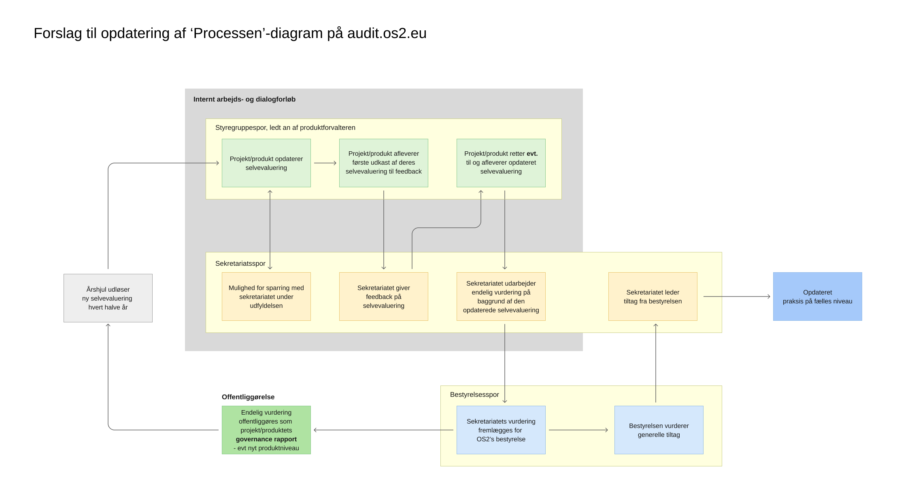

**Process-analyse:**
   - forslag til ændringer i evaluerings-flowet fra start til slut, som vil understøtte og løfte dem, der udfylder (produktforvaltere) og dem der vurderer (sekretariatet)
   - 
   - uddrag pointer fra interviews om årshjul og deres opfattelser af næste skridt (særligt hvor ofte den skal ligge samt timingen heraf)
   - input til publicering på hjemmesiden (heri også 
   - tag fat i modellen og udpeg dét, som ikke giver mening (henvis til int m M, der prøvede at afkode den)
   - tag fat i emailen de fik første gang; wordingen og link-henvisningen til blot selv-eva formularen 
- [empiri: følelser og praksis omkring formularen:]{.underline}
datadrevet, udledt fra interviews hvilke store/gennemgående temaer (sekundære koder), der siger noget der rager udover formular kravene, men som vil hjælpe på praksis

# Kommunikation af governance-processen

Denne analyse ser på, hvordan governance-processen omkring selvevalueringen bliver kommunikeret til produktforvalterne. Jeg ændrer altså ikke selve processen her, men ser på, om den bliver forklaret tydeligt nok til, at produktforvalterne og sekretariatet har nogenlunde samme forståelse af, hvad der skal ske hvornår.

Analysen bygger især på interviewenes kode 7 om proces og årshjul, kode 12 om offentlighed og udvalgte dele af kode 13 om vurdering og mulighed for rettelser. Mathias' brugertest af audit.os2.eu bruges også, fordi den viser ret tydeligt, hvor en ny produktforvalter selv skal gætte sig frem.

Som teoretisk blik bruger jeg Hall og hans encoding/decoding-model. Det interessante her er forskellen mellem det, OS2 prøver at kommunikere, og det produktforvalterne faktisk ender med at forstå. McLuhan bruges mere løst til at se på, hvad de forskellige medier gør ved kommunikationen. En email, en hjemmeside og et procesdiagram kan ikke det samme og bør derfor heller ikke bruges til det samme.

## 1. Der er ikke én fælles forståelse af årshjulet

Det første der går igen i interviewene er usikkerhed om, hvor ofte selvevalueringen egentlig foregår, og hvornår på året den ligger.

Flere husker processen som noget årligt, mens andre er i tvivl om, hvorvidt den er årlig eller halvårlig. To forskellige frister bliver også nævnt som forvirrende. Samtidig opleves fristen flere steder som for kort, og sommerperioden fungerer dårligt.

Tre produktforvaltere siger direkte, at de ikke rigtig er blevet sat ind i årshjulet. Andre kan huske dele af processen, men ikke den samlet.

Det er et ret klart eksempel på det, Hall peger på: Sekretariatet kan godt have kommunikeret en bestemt proces, men det er ikke nødvendigvis den samme proces, modtagerne står tilbage med bagefter.

**Retning:** Årshjul, frekvens og frister skal forklares ét sted og derefter gå igen på samme måde i email, hjemmeside og diagram.

## 2. Næste skridt efter aflevering er for uklart

Der er også flere, som er i tvivl om, hvad der sker, når selvevalueringen er afleveret. Nogle forventer feedback fra sekretariatet, men andre husker kun meget løst, hvad næste skridt er.

Det samme skete i Mathias' brugertest. Efter at have været rundt på sitet havde han en idé om, hvad der nok ville ske bagefter, men han måtte i høj grad selv regne det ud. Han forventede blandt andet, at materialet blev publiceret og derefter brugt som grundlag for videre arbejde i projektet.

Det interessante er, at han ikke nødvendigvis tog helt fejl. Problemet er mere, at rækkefølgen ikke står klart nok. Produktforvalteren skal helst ikke selv stykke processen sammen ud fra forskellige sider og formuleringer.

Interviewene viser samtidig, at flere forventer mulighed for at reagere på sekretariatets tilbagemelding, rette dokumentation og nå at justere noget, før vurderingen bliver endelig.

**Retning:** Det bør stå helt enkelt, hvad der sker efter aflevering:

**aflevering → feedback → mulighed for rettelser → endelig vurdering → offentliggørelse**

## 3. Det er uklart, hvornår noget bliver offentligt

Her er der et ret tydeligt mismatch mellem sekretariatets og flere produktforvalteres forståelse.

Mange synes grundlæggende, at åbenhed om governance passer godt til OS2. Det betyder bare ikke, at de automatisk forventer, at deres første selvevaluering ligger offentligt.

Flere fortæller, at de ikke vidste det, og nogle siger direkte, at de ville have skrevet anderledes, hvis de havde været klar over det fra starten. Især oplysninger om fx code review eller andre svagheder kan være noget, man gerne vil kunne beskrive ærligt i et arbejdsdokument, før det ligger åbent.

Mathias kunne heller ikke finde et tydeligt svar på sitet. Han kunne godt læse, at der på et tidspunkt kommer en officiel vurdering, men selve offentliggørelsen skulle efter hans egen formulering lidt "læses mellem linjerne". Han pegede også på, at det kan påvirke, hvor åbent man skriver, hvis man er usikker på, hvem der kan se besvarelsen.

Det hænger tæt sammen med interviewenes ønske om at bruge selvevalueringen som et arbejdsredskab først og offentliggøre noget senere i forløbet.

**Retning:** Det skal stå allerede inden man går i gang med formularen, hvad der er internt, hvad der bliver offentligt senere, og hvornår det sker.

## 4. Processen er spredt ud over flere medier

Produktforvalteren møder ikke processen ét sted. Den bliver kommunikeret gennem email, audit-sitet og procesdiagrammet.

Det er ikke nødvendigvis et problem i sig selv. De tre formater kan forskellige ting. Problemet opstår, når man selv skal samle dem for at forstå hele forløbet.

Mathias kunne fx godt lide procesdiagrammet, fordi han hurtigt kunne se styregruppesporet og bestyrelsessporet. Til gengæld oplevede han det også som lidt overvældende og efterspurgte et mere lineært forløb. Senere beskrev han sitet som meget transparent, men også som transparent "på bekostning af forståelse om processen og det samlede forløb og stadierne derunder".

Her giver McLuhan mening som et lille ekstra blik. Emailen skal ikke kunne det samme som hjemmesiden, og diagrammet skal heller ikke rumme alle detaljer. Til gengæld skal de tre dele støtte hinanden og fortælle den samme version af processen.

# Forslag til forbedringer

## 1. Emailen skal starte processen ordentligt

Emailen er for mange det første møde med selvevalueringen og bør derfor gøre det meget nemt at forstå:

* hvorfor man får mailen

* hvad man skal gøre nu

* hvornår fristen er

* hvor ofte selvevalueringen foregår

* hvad der sker efter aflevering

* hvornår man får feedback

* hvad der senere bliver offentliggjort

Mailen behøver ikke forklare hele governance-processen. Den skal først og fremmest få modtageren godt i gang og sende videre til ét tydeligt sted på audit.os2.eu.

## 2. Hjemmesiden skal være det sted man altid kan gå tilbage til

Audit.os2.eu bør være det faste sted, hvor den gældende proces står samlet.

Hvis man bliver i tvivl om næste skridt, frister, feedback eller offentliggørelse, skal svaret kunne findes her uden at man skal lede på tværs af en masse undersider, eller lede i emailen, som pt er det eneste sted fristen står.

Det hænger direkte sammen med forslagene fra analysen af selve sitet. Processen bør følge de samme begreber hele vejen igennem og tydeligt skelne mellem selvevaluering, feedback, rettelser og endelig vurdering.

## 3. Diagrammet skal først og fremmest give overblik

Procesdiagrammet fungerer bedst som overblik og behøver ikke rumme alle detaljer.

Jeg ville derfor gøre det mere lineært og lade hovedforløbet være det første man ser:

**orientering → udfyldelse → aflevering → feedback → rettelser → endelig vurdering → offentliggørelse**

Roller og ansvar kan stadig fremgå, fordi det var noget af det Mathias faktisk syntes fungerede godt.

Det bør også være meget tydeligt i diagrammet, hvornår noget stadig er **internt/kladde**, og hvornår man når til **endelig/offentlig vurdering**.

forslag til diagram
- 

## Procesdiagrammet bør skitsere forløbet tydeligere

Interviewene og brugertesten viser, at procesforløbet ikke bliver forstået ens, og at det oprindelige diagram er svært at aflæse som et samlet forløb. Med udgangspunkt i usability-testen (Hertzum, 2020) og walkthrough-analysen (Light et al., 2018) har jeg derfor lavet et forslag, der tydeliggør rækkefølge, ansvar og overgangen fra internt arbejde til offentlig vurdering og samtidig gør diagrammet mere overskueligt visuelt.

Det oprindelige procesdiagram giver et fint overblik over, at både styregruppe og bestyrelse indgår i processen, men flere af overgangene er svære at forstå. Styregruppen kommer først tydeligt ind efter sekretariatets evaluering, selv om styregruppen og produktforvalteren allerede har ansvar for selvevalueringen fra starten. Samtidig er det uklart, hvad “dialog med sekretariatet” dækker over, og hvornår processen går fra første aflevering til feedback, rettelser og endelig vurdering.

Bestyrelsessporet er også svært at aflæse. Det fremgår ikke tydeligt, hvad “generelle tiltag” betyder, eller hvad pilene mellem styregruppe- og bestyrelsessporet viser. Sekretariatet optræder samtidig flere steder i begge spor, selv om sekretariatet i praksis har sin egen rolle mellem produktet og bestyrelsen.

I mit forslag har jeg derfor lavet **tre tydelige spor for styregruppe, sekretariat og bestyrelse**. Det gør det lettere at se, hvem der har ansvar hvornår, og gør feedbackforløbet mere tydeligt: første aflevering → sekretariatets feedback → eventuelle rettelser → endelig vurdering. Jeg har også markeret det interne arbejds- og dialogforløb særskilt fra offentliggørelsen, så det bliver tydeligt, hvornår processen går fra intern behandling til et offentligt resultat.

Jeg har samtidig gjort diagrammet **horisontalt og mere lineært**, så processen læses fra venstre mod højre. Det var også noget Mathias efterspurgte i brugertesten, hvor han oplevede det oprindelige diagram som lidt overvældende, især da man ikke kunne overskue det i ét browser vindue, fordi det var så langt. For at udnytte 'dead space' på siden har jeg lavet mit forslag horisontalt.

**Retning:** Behold overblikket over rollerne, men gør selve procesforløbet mere lineært og tydeligt, så det hurtigt kan aflæses, hvem der gør hvad, hvornår der kan rettes til, og hvornår vurderingen bliver endelig og offentlig.

**Nuværende proces-diagram**

**Forslag til opdatering af proces-diagram**

