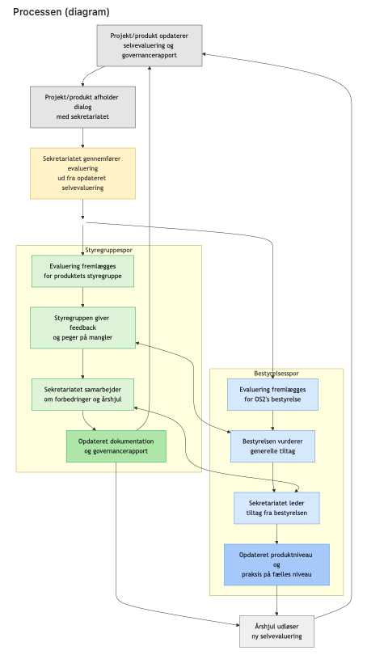
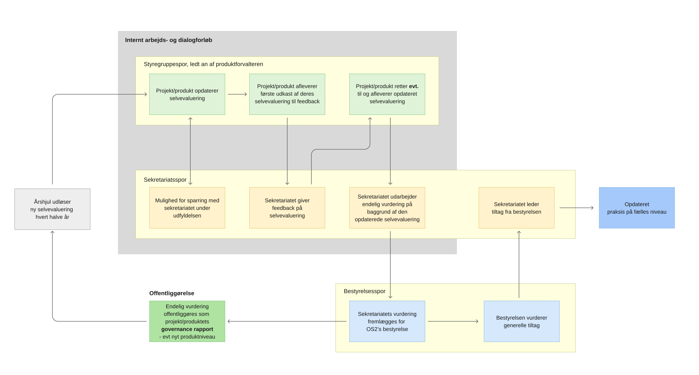

# 3. Analyse af processen omkring selvevalueringer i OS2

### Hvad undersøges og hovedfund 

Interviewene med produktforvaltere viser en gennemgående forvirring om selvevalueringsprocessen: Hvor ofte foregår den, hvad sker der efter aflevering, hvornår kan man rette til, og hvornår bliver noget offentligt? Problemet er ikke hvordan processen er designet, men hvordan den kommunikeres, når at produktforvalterne ikke står tilbage med den samme forståelse af processen.

Analysen ser derfor på kommunikationen af processen omkring selvevalueringen, især orienterings-emailen produktforvalterne blev sendt tilbage d.11 maj, audit.os2.eu og procesdiagrammet på hjemmesiden. Min hovedanbefaling er derfor at gøre kommunikationen om processen mere entydig på tværs af de tre medier. 

### Hvordan?

Analysen bygger på interviews, dokumentanalyse af emailen, walkthrough, brugertest af audit.os2.eu. Interviewanalysen tager især udgangspunkt i 3 temaer, der åbenbarede sig i empirien: \
- "Tvetydighed om selvevaluerings årshjul"\
- "Ikke orienteret om at selvevaluering skal ligge åbent"\
- og "Syn på niv-sætning & vurdering - endelig eller ikke?"

Teori-wise, bruges Hall som blik på forskellen mellem det, OS2 forsøger at kommunikere (encoding), og det produktforvalterne faktisk forstår (decoding). McLuhans begreb om "medium is the message" bruges til at skelne mellem medier og hvad email, hjemmeside og diagram hver især bør bruges til.

## Hovedfund

### 1. Årshjulet bliver ikke forstået ens

Det empiriske tema viser, at der ikke er en fælles forståelse af processen. I kodningen af interviews optræder både for korte deadlines og en opfattelse af processen som årlig på tværs af interview, selv om selvevalueringen er tænkt som en halvårlig proces (som beskrevet i orienteringsemailen og på forsiden af audit.os2.eu). Der er også stor usikkerhed om de forskellige frister og om, hvad næste skridt er efter aflevering. Kun to ud af de 6 interviewede havde besøgt audit-sitet, de var begge faret vild derinde og ingen af dem kunne overskue diagrammet.

Det peger på et ret grundlæggende kommunikationsproblem: Produktforvalterne kan godt have modtaget informationen, uden at de dermed har fået en klar mental model af forløbet. 

### 2. Det er uklart, hvilken status selvevalueringen har

Temaet om åbenhed viser et skel mellem generel opbakning til åbenhed og konkret viden om, hvad der bliver offentligt. Flere synes, at åbenhed passer naturligt til OS2, men det betyder ikke, at de forventer, at det de sidder og udfylder, senere bliver offentligt.

Hvor det i halvdelen af interviews var implicit, at deres selvevaluering ville blive lagt op offentligt, vidste den anden halvdel af produktforvaltere ikke vidste, at selvevalueringen var åben, og nogle nævnte, at de ville have udfyldt den anderledes med den viden. Det er vigtigt, fordi offentlighed dermed kan påvirke, hvor åbent man beskriver fx mangler eller problemer.

Det bør derfor stå tydeligt allerede inden udfyldelsen, hvilken status dokumentet har, og hvornår noget eventuelt går fra internt arbejdsdokument til offentligt materiale.

### 3. Ingen ved, hvornår vurderingen er endelig

Temaet her viser især et behov for at kunne reagere på sekretariatets vurdering. Manglende tid eller frist til at justere efter vurderingen optræder særligt i et interview, mens ønsket om at kunne rette inden offentliggørelse optræder på tværs af flere interviews. Selvevalueringen opfattes og beskrives flere gange som et arbejdsredskab af alle produktforvalterne, med en forventning om, at bør kunne ændres undervejs - men alle er i tvivl om hvornår og I hvilket stadige, at rapporten offentliggøres for bestyrelsen og lægges op offentligt. 

Det centrale er derfor at gøre rækkefølgen tydelig:

**aflevering → feedback → mulighed for rettelser → endelig vurdering → offentliggørelse**

Det skal være klart, hvornår noget stadig er til dialog, og hvornår processen er afsluttet. I Mathias' brugertest af audit.os2.eu blev han stillet til opgave at opnå forståelse for processen. Hans 

### Samlet set

På tværs af de tre temaer er problemet det samme: OS2 kommunikerer en proces, men produktforvalterne afkoder ikke nødvendigvis processen på samme måde. Der er altså forskel mellem den tilsigtede kommunikation og den forståelse, modtageren ender med.

Det betyder ikke, at hele processen skal forklares endnu i dybden i både orienteringsemailen, på alle hjemmesides undersider og i proces-diagrammet. Det betyder, at hvert medie har en form, der former hvor høj grad af processen de hver især de kan kommunikere på en meningsfuld og tilgængelig måde. Ifølge McLuhans "medium is the message" teori, har en læser forskellige forventninger til hvor meget og hvilken slags information de kan indtage fra hhv. en email, hjemmeside og et diagram. Kunsten er at skabe god sammenhæng imellem de tre, der understøtter den samme forståelse af forløbet, på hver sin måde.

# Ændringsforslag: Bedre kommunikation på tværs
Mit forslag er, at emailen sætter processen i gang, hjemmesiden forklarer den i dybden og diagrammet giver overblikket: 

### Emailen skal være kortere og få produktforvalteren i gang

Emailen er det første møde med processen for mange produktforvaltere, og vil fremadrettet blive en reminder om "nu er det tid til evaluering - igen". Orienteringsemailen bør derfor først og fremmest fortælle, hvorfor man får den, hvad man skal gøre nu, hvornår fristen er og hvor man går hen for at læse mere.

Den første orienteringsemail fra 11. maj forsøgte i højere grad at rumme hele processen og kommer derfor til at ligne en FAQ. Jeg vil i stedet bruge den som en kort indgang til processen med henvisningslinks der uddyber processen på audit.os2.eu.

### Hjemmesiden skal være det faste referencepunkt med en god navigation

Audit.os2.eu bør være det sted, man går tilbage til, hvis man er i tvivl om frister, næste skridt, feedback eller offentliggørelse. Det betyder også, at emailen mister status som referencepunkt, men bliver en orientering, og hjemmesiden bliver en wiki.

Forslagene til en tydeligere forside og simplere navigation på audit.os2.eu behandles allerede i delanalyse 2. 
Det gennemgående problem, der blev afdækket i analysen omkring hjemmesiden, var at det som produktforvalter var svært at gennemskue hvor de skulle starte og hvilke undersider der var relevante for dem. Se uddybning af hjemmesidens udfordringer for produktforvalterne [i del-analyse 2.](https://anna-leland.github.io/digi-suveraenitet-i-praksis/docs/os2forloeb2026/selvevalueringer/2-analyse-UI-audit-sitet.html)

### Procesdiagrammet skal give overblik

Diagrammets vigtigste opgave bør være at gøre forløbet overskueligt fra start til slut. Det skal derfor ikke indeholde alle detaljer; de bliver uddybet på hjemmesidens undersider. Diagrammet skal tydeligt vise rækkefølge, ansvar og overgangen fra internt arbejdsforløb til endelig offentlig vurdering.

På baggrund af interviewempiri, brugertesten med Mathias (som aldrig havde set diagrammet før) og min egen walkthrough-analyse har jeg lavet et forslag til et ny version af procesdiagrammet, hvor processen forhåbentligt kommunikeres tydeligere. 

Det oprindelige procesdiagram giver et fint overblik over, at både styregruppe og bestyrelse indgår i processen, men flere af overgangene er svære at forstå. Styregruppen kommer først visuelt ind efter sekretariatets evaluering, selv om styregruppen og produktforvalteren allerede har ansvar for selvevalueringen fra starten. Samtidig er det uklart, hvad “dialog med sekretariatet” dækker over, og hvornår processen går fra første aflevering til feedback, rettelser og endelig vurdering.

Bestyrelsessporet er også svært at aflæse. Det fremgår ikke tydeligt, hvad “generelle tiltag” betyder, eller hvad pilene mellem styregruppe- og bestyrelsessporet viser. Sekretariatet optræder samtidig flere steder i begge spor, selv om sekretariatet i praksis har sin egen rolle mellem produktet og bestyrelsen.

I mit forslag har jeg derfor lavet **tre tydelige spor for styregruppe, sekretariat og bestyrelse**. Det gør det lettere at se, hvem der har ansvar hvornår, og gør feedbackforløbet mere tydeligt:\
første aflevering → sekretariatets feedback → eventuelle rettelser → endelig vurdering.\
Jeg har også markeret det interne arbejds- og dialogforløb særskilt fra offentliggørelsen, så det bliver tydeligt, hvornår processen går fra intern behandling til et offentligt resultat.

Jeg har samtidig gjort diagrammet **horisontalt og mere lineært**, så processen læses fra venstre mod højre. Det var også noget Mathias efterspurgte i brugertesten, hvor han oplevede det oprindelige diagram som overvældende, især da man ikke kunne overskue det i ét browser vindue, fordi det var så langt. For at udnytte 'dead space' på siden har jeg lavet mit forslag horisontalt. 

**En note om formater**: Det er mit indtryk, at formuleringerne i tekstboksene til dels er skyld i manglende overblik i diagrammet, men det virker også til, at selve Mermaids-diagram struktur er med til at spænde ben. Jeg har derfor tegnet mit diagram i Figma, men downloadet det som en SVG-fil, så den kan lægges ind i .md-filer og trods man giver afkald på versionsstyringen i Git som Mermaid tilbyder, vil SVG-filen kunne hentes ned og nemt redigeres i fx. Figma og lægges op igen uden at miste kvaliteten, som hvis det havde været et PNG.

**Nuværende proces-diagram**

**Forslag til opdatering af proces-diagram**

 
